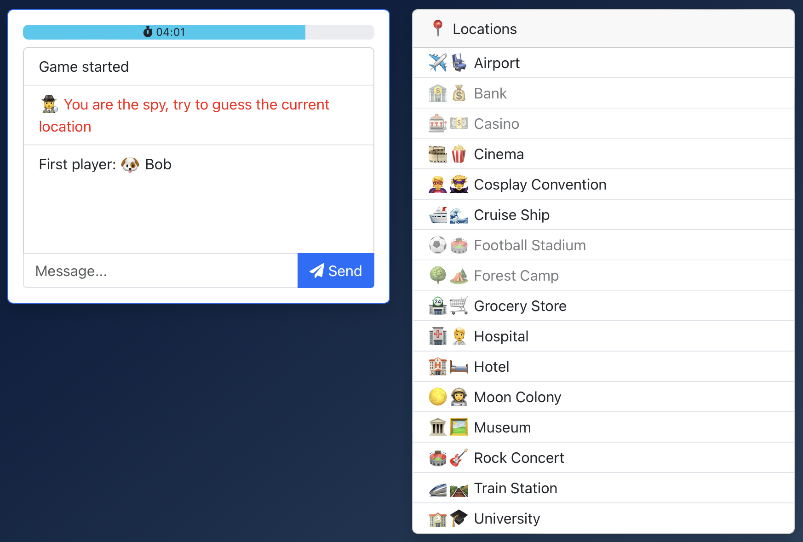

# 🕵️ Spyfall

[](./LICENSE.txt)
[](https://github.com/VeryBadFrags/spyfall/releases/latest)
[](https://github.com/VeryBadFrags/spyfall/actions/workflows/validate-server.yml?query=branch%3Amain)
[](https://github.com/VeryBadFrags/spyfall/actions/workflows/validate-client.yml?query=branch%3Amain)
[](https://app.netlify.com/sites/heuristic-bartik-850df8/deploys)

A multiplayer social deduction game inspired by [Spyfall](https://hwint.ru/portfolio-item/spyfall/).

- [▶️ Play the game](https://spyfall.verybadfrags.com)



## Stack

🛠️ Built with [Node](https://nodejs.org/en),
[React](https://react.dev),
[Bootstrap](https://getbootstrap.com),
[Typescript](https://www.typescriptlang.org),
and [socket.io](https://socket.io).

## Repository layout

This is a [pnpm workspace](https://pnpm.io/workspaces):

- [🧑‍🎨 `packages/client`](packages/client) - the React web app (deployed on Netlify)
- [🤖 `packages/server`](packages/server) - the socket.io server (published as a Docker image)

## Local setup

### With [mise](https://mise.jdx.dev)

```sh
mise install # only required once
mise dev
```

### With [Node](https://nodejs.org)

```sh
corepack enable
pnpm install
pnpm dev # runs the server & client in parallel
```
